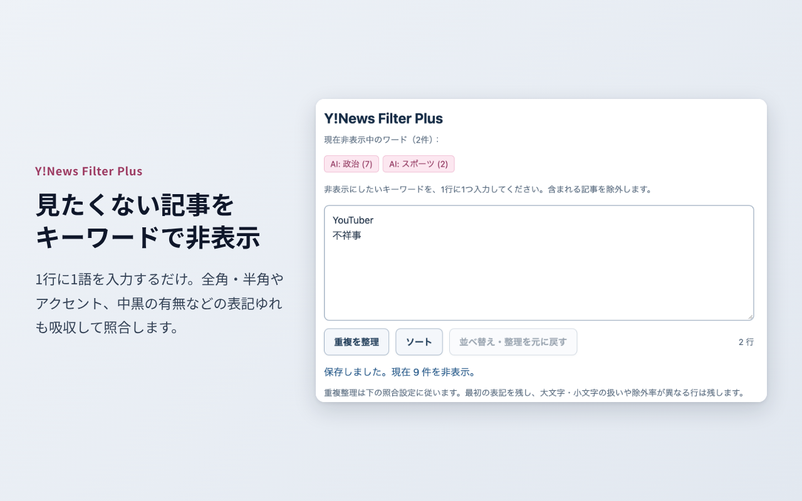
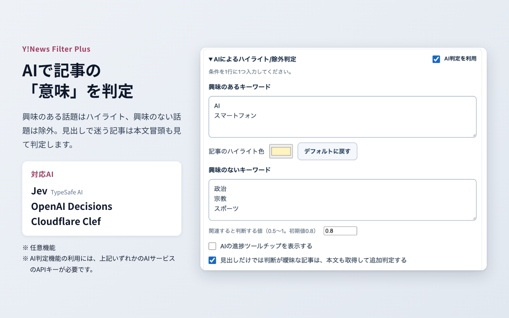
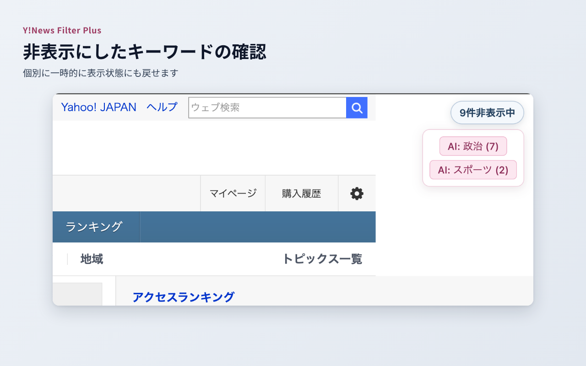

# Y!News Filter Plus

Yahoo!ニュースの記事一覧を、キーワード、または AIによる関連性判定でハイライト・除外する Chrome 拡張です。Yahoo! JAPAN とは無関係な非公式のソフトウェアです。

## スクリーンショット







## 機能

- **キーワード除外**：指定した語を含む記事カードを非表示にします。全角・半角、アクセント、中黒の有無などの表記ゆれを吸収して照合します。
- **AI による判定（オプション）**：「興味のあるキーワード」に関連する記事をハイライトし、「興味のないキーワード」に関連する記事を除外します。見出しだけでは判断が曖昧な記事は、本文冒頭も取得して追加判定できます。
- **Chrome 同期**：キーワードと判定条件を、同じ Google アカウントの Chrome 間で同期します。同時編集の競合は自動で上書きせず、比較して選べます。
- **一時停止**：「非表示中」チップにマウスを載せると左上へ現れる赤い一時停止ボタンで、非表示・ハイライトをまとめて解除できます。緑の再生ボタンで再開します。設定画面の「除外/ハイライトを一時停止／再開」と連動し、保存した設定は変更しません。
- **判定詳細**：AI の判定値・採用した根拠・エラーを表で確認し、TSV でコピーできます。AI判定OFF・条件未設定・全体の一時停止・フィルターOFFで判定しない記事は「通常表示」に分類します。AI判定を利用する未取得行には、判定予定の接続先・モデルと「未判定」を表示します。送信記録があり結果がない場合は「判定結果なし」と区別し、未送信・順番待ち・応答待ちの理由は詳細で確認できます。
- **Consoleに継続出力（デバッグ用）**：Yahoo!ニュースのページ上で設定を開いて利用します。設定専用ページには表示しません。通常はOFFで使用します。ONは同じタブの再読み込みで維持し、タブを閉じると解除します。新しいタブではOFFです。Chrome同期・設定JSONには含めません。
- **設定の書き出し・読み込み**：JSON でバックアップ・移行できます。直近 10 件の保存履歴から復元もできます。

## AI判定の接続先

AI判定は任意の機能で、**初期状態では無効**です。次の3種類の接続先に対応します。

| 接続先 | 必要な設定 |
| --- | --- |
| Jev（初期値） | TypeSafeのAPIキーのみ。既存のキーを引き継ぎます |
| OpenAI Decisions | OpenAI APIキー。モデルは `gpt-6-luna` |
| Cloudflare Clef / Clef-flash | CloudflareアカウントID、Workers AI権限のあるAPIトークン、モデルの選択 |

Clef・OpenAIでは「この接続先への通信を許可」を押し、ブラウザの権限を許可してください。APIの応答は最大30秒待ちます。

接続先・モデル・URL・APIキーは端末内に保存し、Chrome同期や設定JSONには含めません。キーは接続先ごとに保存します。キャッシュも接続先とモデルで分離します。モデルを変えた場合は判定値の傾向を確認し、必要に応じてしきい値を調整してください。

有効にすると記事の見出し（本文追加判定を有効にした場合は本文冒頭も）と判定条件を選択した接続先へ送信します。キーを変更すると、短い「接続確認」の判定要求を送ります。**クラウドAPIの料金は利用者と接続先のサービスとの契約に基づいて発生します。** 本拡張の開発者は料金を受け取らず、APIキーや判定内容を取得しません。詳細は[プライバシーポリシー](docs/PRIVACY_POLICY.md)をご覧ください。

接続仕様：[Clef](https://developers.cloudflare.com/workers-ai/models/clef/)、[OpenAI Decisions](https://developers.openai.com/api/docs/guides/decisions)。

設定手順： [Jev](docs/JEV_SETUP.md) ／ [OpenAI Decisions](docs/OPENAI_DECISIONS_SETUP.md) ／ [Cloudflare Clef](docs/CLOUDFLARE_SETUP.md)

## 導入

[Chrome Web Store](https://chromewebstore.google.com/detail/khglaaonfjfngjlfecbofoapgngafaod) からインストールできます。

開発版を使う場合は、`npm run build:extension` でビルドし、`chrome://extensions` でデベロッパーモードを有効にして「パッケージ化されていない拡張機能を読み込む」から `dist/` を選びます。

## 使い方

1. Yahoo!ニュース（`news.yahoo.co.jp`）を開くと、ページ右上に「○件非表示中」のチップが表示されます。チップまたはツールバーの拡張アイコンをクリックすると設定画面が開きます。Yahoo!ニュース以外のページでは、拡張アイコンから設定専用タブが開きます。
2. 「除外キーワード」に非表示にしたい語を 1 行に 1 つ入力します。設定は自動保存されます。
3. 行末に `||` を付けると、その行だけの条件を指定できます。
   - `ABC||case:1`：大文字・小文字を区別する（`case:0` で区別しない）。
   - `単語||rate:90`：一致した 10 件のうち 9 件を除外する。`rate:90!` は先頭の 1 件を表示して残りを除外します。
4. AI判定を使う場合は「AIによるハイライト/除外判定」を開き、「AI判定を利用」をオンにして接続先を設定し、興味のある／ないキーワードを入力します。
5. チップにマウスを載せると、現在非表示にしている語の一覧が出ます。語をクリックすると一時的に除外を解除できます。

動作対象のドメインは `news.yahoo.co.jp`、`www.yahoo.co.jp`、`sports.yahoo.co.jp`、`baseball.yahoo.co.jp`、`soccer.yahoo.co.jp`、`keiba.yahoo.co.jp` です。

## Chrome 同期

初期状態では有効です。同じ Google アカウントで Chrome の拡張機能同期を有効にする必要があります。設定画面の「複数端末間の Chrome 同期」から停止できます。

- 同期するもの：通常キーワード、AI の条件・有効状態・数値パラメータ・表示設定。
- 端末内のみ：AI接続設定・APIキー、判定キャッシュ、保存履歴。
- ページ内のみ：一時解除、通信統計と詳細ログ。
- 手動で開いた判定詳細の表は、ブラウザのセッション保存領域に置き、ブラウザを閉じると消えます。

## ビルド

Node.js 22.12 以降を使用します（作成時検証：Node.js 26）。

```sh
npm ci
npm run icons
npm test
npm run build
npm run package
```

`npm run package` で `release/ynews-filter-plus-<version>.zip` と sha256 が生成されます。

## 構成

- `src/content/engine.js`：記事抽出、通常除外、AI判定・キャッシュ、設定 UI。
- `src/content/selectors.js`：記事カードのセレクター定義（原作由来）。
- `src/shared/settings.js`：設定の検証・正規化・移行形式。
- `src/shared/bridge.ts`：ページ／設定 UI から拡張基盤へのアダプター。
- `src/shared/sync.ts`：分割・検証・競合検出。
- `src/shared/hosts.ts`：動作対象ドメインの一覧。
- `src/background/`：保存の直列化、Chrome 同期、AI／本文通信、表のタブ作成。
- `src/dashboard/`：Yahoo を開いていなくても使用できる設定ページ。
- `src/report/`：判定詳細の HTML 表・絞り込み。

## プライバシー

本拡張は開発者のサーバーを持たず、利用者のデータを開発者や広告・解析事業者へ送信しません。通信先は Yahoo! JAPAN の上記ドメインと、利用者が設定・選択したAI接続先（TypeSafe・Cloudflare・OpenAI）です。詳細は [docs/PRIVACY_POLICY.md](docs/PRIVACY_POLICY.md) をご覧ください。

## 原作

本プロジェクトは、[web-rice](https://github.com/web-rice) 氏の [Y!News Excluder](https://github.com/web-rice/yahoo-news-excluder) を基にした派生版（フォーク）です。原作のセレクター定義を引き継ぎ、表記ゆれを吸収するキーワード照合、Jev によるハイライト・除外判定、Chrome 同期などを追加しています。

## ライセンス

追加実装は [MIT ライセンス](LICENSE)です。原作由来のコードは ISC ライセンスに従い、著作権表示とライセンス全文を [THIRD_PARTY_NOTICES.txt](public/THIRD_PARTY_NOTICES.txt) に保持し、配布 ZIP にも同梱します。本プロジェクトは Yahoo! JAPAN とは無関係な非公式品であり、原作の公式後継製品でもありません。

### 使用中の開発版を保護するビルド

`npm run build` は検証用の `.build-check/` に出力し、Chromeで読み込み中の `dist/` は変更しません。パッケージ作成も検証用出力を使用します。開発版を更新する時だけ `npm run build:extension` を実行し、その後 `chrome://extensions` で拡張を再読み込みしてからニュースページを再読み込みしてください。使用中の `dist/` を更新すると、Chromeが記憶している旧ファイル名と食い違い、ページの再読み込みだけでは起動しないことがあります。
